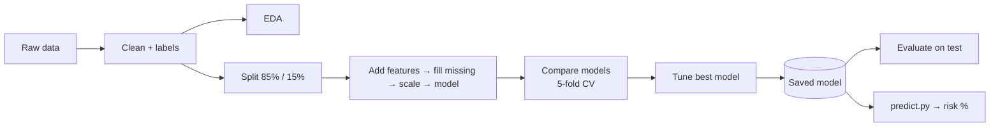

# Fire Crisis Risk Prediction

Predict the **chance (%) that a wildfire gets within 5 km of an evacuation zone** within **12, 24, 48 and 72 hours**, using only the first 5 hours of data about the fire.

Data: WiDS Worldwide Global Datathon 2026.

## 1. The problem

Each fire in `train.csv` has two answers:
- `event`: 1 = the fire reached the evacuation zone, 0 = it didn't (as far as we know)
- `time_to_hit_hours`: when it reached the zone, or when we stopped watching it

We train **one classifier per time limit** (12, 24, 48 and 72 h). Risk % = `predict_proba × 100`.

**Competition rule:** if we stopped watching a fire *before* a time limit, we don't know what happened, so that fire is **skipped** for that limit.

**Score (higher is better):**
```
Hybrid = 0.3 × C-index + 0.7 × (1 − Brier)
Brier  = 0.3 × Brier@24h + 0.4 × Brier@48h + 0.3 × Brier@72h
```
- **C-index:** are the most urgent fires ranked first?
- **Brier:** are the percentages accurate? (lower is better)

## 2. Data

| File | Rows | Content |
|---|---|---|
| `data/raw/train.csv` | 221 | 34 features + answers |
| `data/raw/test.csv` | 95 | 34 features, no answers |
| `data/raw/sample_submission.csv` | 95 | the competition's answer format |
| `data/raw/metaData.csv` | 37 | column descriptions |

The features describe each fire's size, growth, speed, direction, distance to the nearest evacuation zone, and start time. There are no missing values.

## 3. Setup and run (in WSL)

```bash
cd "/mnt/c/Users/<you>/OneDrive/Desktop/New folder/fire-risk-model"
export UV_PROJECT_ENVIRONMENT=$HOME/.venvs/fire-risk-model   # put this in ~/.bashrc
uv sync                                                      # install packages
uv run jupyter lab --no-browser                              # open the notebooks
```

Run the notebooks in order: **01 → 02 → 03** (about 1 minute in total). Or run them all from the terminal:
```bash
uv run jupyter nbconvert --to notebook --execute --inplace notebooks/*.ipynb
```

## 4. Project structure

```
data/raw/          original files (never changed)
data/processed/    cleaned training data
data/test/         test split + sample input/output
notebooks/         01_eda, 02_training, 03_evaluation
src/data.py        load data, make labels
src/features.py    extra features
src/model.py       the model + competition score
src/predict.py     command line: predict a CSV file
models/            saved model
reports/           charts, predictions, submission.csv
```

## 5. Pipeline



## 6. What the data shows

1. Only **31%** of fires reach the zone, and most do it fast. See [01_target.png](reports/figures/01_target.png).
2. **Distance decides almost everything:** every fire that hit started within 4.7 km of the zone, and every fire that didn't was more than 5.2 km away. *When* a fire hits is the hard part. See [01_distance.png](reports/figures/01_distance.png).
3. Distance features are the most linked to a hit. See [01_top_features.png](reports/figures/01_top_features.png).

## 7. Results

**Model comparison (5-fold CV, Hybrid score):** [02_model_comparison.png](reports/figures/02_model_comparison.png)

| Model | Hybrid score |
|---|---|
| Baseline (guess the average) | 0.738 |
| Logistic Regression | 0.939 |
| Gradient Boosting | 0.970 |
| Random Forest | 0.972 |
| **Random Forest (tuned)** | **0.976** |

**Test set (34 unseen fires):**

| Score | Result |
|---|---|
| **Hybrid** | **0.971** |
| C-index | 0.933 |
| Brier | 0.013 |

Charts: [03_confusion_48h.png](reports/figures/03_confusion_48h.png), [03_calibration.png](reports/figures/03_calibration.png), [03_feature_importance.png](reports/figures/03_feature_importance.png)

## 8. Predict new fires

```bash
uv run python src/predict.py --input data/test/sample_input.csv --output predictions.csv
```

The output contains your columns plus:
- `risk_12h_pct` … `risk_72h_pct`: risk % for each time limit
- `risk_percentage`: the main risk (the **48 h** risk)
- `risk_band`: Low (0–25%), Medium (25–50%), High (50–75%) or Critical (75–100%)

To also create the competition file, add `--submission reports/submission.csv`.

## 9. Results dashboard

Open **`reports/dashboard.html`** in any browser (double-click it). It shows the key results for stakeholders: scorecard, charts, and a filterable table of risk for every new fire. It needs internet once, to load the chart library.

To rebuild it after retraining the model:
```bash
uv run python src/export_results.py        # recompute the numbers
uv run python src/build_dashboard_html.py  # write reports/dashboard.html
```

## 10. Limitations

- Only 221 fires in total.
- The model depends almost only on distance.
- It is weaker at predicting *when* a fire hits.
- The 72 h value (about 98% for every fire) is a side effect of the scoring rule. Use the 12/24/48 h values for decisions.
- No weather, wind or terrain data. Adding these is the best next step.
