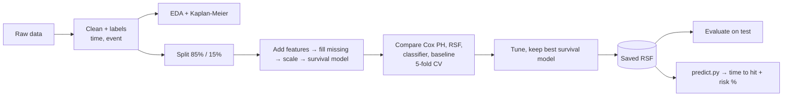
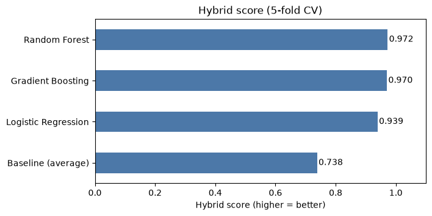
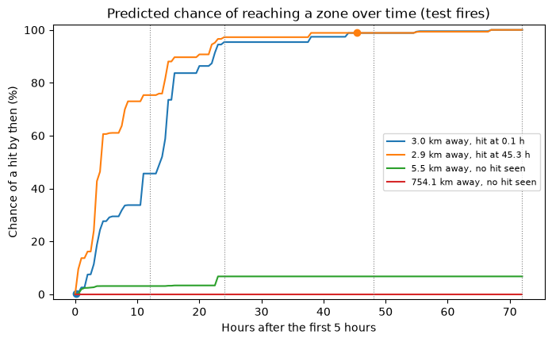

# Wildfire Evacuation Risk: Survival Analysis

Predict **when a wildfire will get within 5 km of an evacuation zone**, and the **chance (%) it happens within 12, 24, 48 and 72 hours**, using only the first 5 hours of data about the fire.


Data: WiDS Worldwide Global Datathon 2026 (see [Data source and terms](#data-source-and-terms)).

**Result:** a Random Survival Forest scores **0.972** on the competition's hybrid metric for unseen fires, against **0.738** for a simple baseline, and predicts hit times with a median error of **1.6 hours**.

> **New here?** Read the step-by-step [Project Guide](docs/PROJECT_GUIDE.md): setup, running, troubleshooting and how to present the results.

## 1. The problem

Each fire in `train.csv` has two answers:
- `event`: 1 = the fire reached the evacuation zone, 0 = **censored** (we stopped watching it before it hit)
- `time_to_hit_hours`: when it reached the zone, or when we stopped watching it

This is **survival analysis**: 69% of fires are censored, so we don't know their full outcome. Survival models learn the whole time-to-hit curve from every fire, censored ones included (a fire last seen at 40 h still tells us it didn't hit for 40 h).

**Core models:**
- **Cox Proportional Hazards (Cox PH):** each feature raises or lowers a fire's rate of hitting by a fixed factor.
- **Random Survival Forest (RSF):** many survival trees averaged together. It can learn sharp rules like "within 5 km". **This is the final model.**

From each fire's survival curve S(t):
- **Risk by time t** = 1 − S(t), read at 12, 24, 48 and 72 h
- **Predicted time to hit** = the hour when the risk passes 50%

For comparison, we also tested one classifier per time limit (no time model) and a baseline that predicts the average.

**Score (competition rule, higher is better):**
```
Hybrid = 0.3 × C-index + 0.7 × (1 − Brier)
Brier  = 0.3 × Brier@24h + 0.4 × Brier@48h + 0.3 × Brier@72h
```
- **C-index:** are fires that hit sooner ranked as more urgent?
- **Brier:** are the percentages accurate? (lower is better; fires whose outcome at a time limit is unknown are skipped)

## Technologies

| Area | Tools |
|---|---|
| Language | Python 3.12 |
| Environment and packages | [uv](https://docs.astral.sh/uv/) (`pyproject.toml` + `uv.lock`), run in WSL (Ubuntu) |
| Survival analysis | scikit-survival (Cox PH, Random Survival Forest, Kaplan–Meier) |
| Machine learning | scikit-learn (pipelines, cross-validation, grid search) |
| Data and charts | pandas, numpy, matplotlib |
| Notebooks | JupyterLab, nbconvert |
| Model saving | joblib |
| Dashboard | Single HTML file with d3.js |

## 2. Data

| File | Rows | Content |
|---|---|---|
| `data/raw/train.csv` | 221 | 34 features + answers |
| `data/raw/test.csv` | 95 | 34 features, no answers |
| `data/raw/sample_submission.csv` | 95 | the competition's answer format |
| `data/raw/metaData.csv` | 37 | column descriptions |

The features describe each fire's size, growth, speed, direction, distance to the nearest evacuation zone, and start time. There are no missing values.

## 3. Setup and run

Requires [uv](https://docs.astral.sh/uv/) on Linux, macOS or WSL (the project was developed in WSL Ubuntu). uv installs Python **3.12**, which scikit-survival needs, automatically.

```bash
git clone https://github.com/Re7absu/wildfire-evacuation-risk.git
cd wildfire-evacuation-risk
uv sync                              # install the exact versions in uv.lock
uv run jupyter lab --no-browser      # open the notebooks
```

> If the folder is inside OneDrive or another synced drive, keep the environment outside it:
> `export UV_PROJECT_ENVIRONMENT=$HOME/.venvs/fire-risk-model` before `uv sync`.

The trained model (`models/fire_risk_model.joblib`, about 21 MB) is included, so `src/predict.py` works without retraining.

Run the notebooks in order: **01 → 02 → 03** (about 1 minute in total). Or run them all from the terminal:
```bash
uv run jupyter nbconvert --to notebook --execute --inplace notebooks/01_eda.ipynb notebooks/02_training.ipynb notebooks/03_evaluation.ipynb
```

## 4. Project structure

```
data/raw/          original files (never changed)
data/processed/    cleaned training data
data/test/         test split + sample input/output
notebooks/         01_eda, 02_training, 03_evaluation
src/data.py        load data, make labels
src/features.py    extra features
src/survival.py    survival models (Cox PH, RSF) + Kaplan-Meier curve
src/model.py       pipeline, per-horizon classifier (for comparison) + competition score
src/predict.py     command line: predict a CSV file
models/            saved model
reports/           charts, predictions, submission.csv, dashboard.html
```

## 5. Pipeline



## 6. What the data shows

1. Only **31%** of fires reach the zone; the rest are censored. See [01_target.png](reports/figures/01_target.png).
2. **Kaplan–Meier curve:** most hits happen in the first 12 hours, then the curve flattens. See [01_kaplan_meier.png](reports/figures/01_kaplan_meier.png).
3. **Distance decides almost everything:** every fire that hit started within 4.7 km of the zone, and every censored fire was more than 5.2 km away. *When* a fire hits is the hard part. See [01_distance.png](reports/figures/01_distance.png).
4. Distance features are the most linked to a hit. See [01_top_features.png](reports/figures/01_top_features.png).

## 7. Results

**Model comparison (5-fold CV):**



| Model | Type | Hybrid ↑ | C-index ↑ | Brier ↓ |
|---|---|---|---|---|
| Baseline (average) | – | 0.738 | 0.500 | 0.160 |
| Cox PH (tuned) | survival | 0.935 | 0.914 | 0.055 |
| Classifier per time limit (tuned) | classification | 0.976 | 0.954 | 0.014 |
| **Random Survival Forest (tuned)** | **survival** | **0.978** | **0.956** | **0.013** |

**Test set (34 unseen fires), Random Survival Forest:**

| Score | Result |
|---|---|
| **Hybrid** | **0.972** |
| C-index (survival risk score) | 0.947 |
| Brier | 0.014 |
| Median error of predicted hit time (fires that hit) | 1.6 hours |
| Fires that never hit and got no predicted hit time | 23 of 23 |



More charts: [03_survival_curves.png](reports/figures/03_survival_curves.png), [03_time_to_hit.png](reports/figures/03_time_to_hit.png), [03_calibration.png](reports/figures/03_calibration.png), [03_feature_importance.png](reports/figures/03_feature_importance.png)

## 8. Predict new fires

```bash
uv run python src/predict.py --input data/test/sample_input.csv --output predictions.csv
```

The output contains your columns plus:
- `predicted_hours_to_hit`: when the fire is expected to reach the zone (empty = not expected)
- `risk_12h_pct` … `risk_72h_pct`: risk % for each time limit
- `risk_percentage`: the main risk (the **48 h** risk)
- `risk_band`: Low (0–25%), Medium (25–50%), High (50–75%) or Critical (75–100%)

To also create the competition file, add `--submission reports/submission.csv`.

## 9. Results dashboard

Open **`reports/dashboard.html`** in any browser (double-click it). It shows the key results for stakeholders: a scorecard, the Kaplan–Meier curve, model comparison, calibration, and a filterable table with the predicted hit time and risk for every new fire. It needs internet once, to load the chart library.

To rebuild it after retraining the model:
```bash
uv run python src/export_results.py        # recompute the numbers
uv run python src/build_dashboard_html.py  # write reports/dashboard.html
```

## 10. Limitations

- Only 221 fires in total.
- The model depends almost only on distance.
- Most predicted hit times are close, but a few late hits are predicted far too early.
- No fire was watched beyond about 67 hours, so the 72 h risk equals the risk at the end of the data.
- No weather, wind or terrain data. Adding these is the best next step.

## 11. Future improvements

- Add weather, wind and terrain features, which the limitations above point to as the biggest gap.
- Validate on more fires, or on a later season, to test how well the model generalises.
- Add unit tests for `src/features.py`, `src/survival.py` and the competition score in `src/model.py`.
- Serve `predict.py` behind a small API so the risk table can be refreshed automatically.

## Data source and terms

The data comes from the **WiDS Worldwide Global Datathon 2026** and is included in `data/raw/` so the notebooks run as-is. It is subject to the competition's data terms; check those terms before reusing the data elsewhere.

## License

The code is released under the [MIT License](LICENSE). The competition data in `data/` is not covered by this license and keeps its original terms (see [Data source and terms](#data-source-and-terms)).
