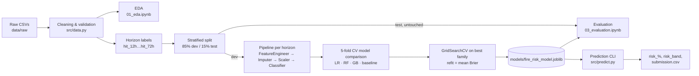

# Fire Crisis Risk Prediction

Predict the **risk (0–100%) that a wildfire comes within 5 km of an evacuation zone** within the next **12, 24, 48 and 72 hours**, using only what was observed in the fire's first 5 hours.

Data: WiDS Worldwide Global Datathon 2026 (wildfire evacuation task).

---

## 1. Goal and problem framing

The raw target is **survival-style**: `time_to_hit_hours` (0–72 h) plus `event` (1 = the fire came within 5 km of an evacuation zone, 0 = it never did within the 72 h window). The data dictionary says `event = 0` means "never hit within 72 h", so each horizon gets a clean **binary** label:

```
hit_h = (event == 1) and (time_to_hit_hours <= h)      for h in {12, 24, 48, 72}
```

We therefore use **classification**: one classifier per horizon, with **risk % = `predict_proba × 100`**. The four probabilities are forced to be non-decreasing (P(12h) ≤ P(24h) ≤ P(48h) ≤ P(72h)), because a fire cannot be less likely to have hit by 48 h than by 24 h. This also produces the competition's submission format (`prob_12h … prob_72h`).

The headline `risk_percentage` reported by the CLI is the **72 h risk**, and `risk_band` is derived from it.

## 2. Dataset

Source folder: `WiDSWorldWide_GlobalDathon26/`, copied unchanged into `data/raw/`.

| File | Rows × cols | Content |
|---|---|---|
| `train.csv` | 221 × 37 | 34 features + `event_id` + targets `time_to_hit_hours`, `event` |
| `test.csv` | 95 × 35 | same features, **no labels** (competition test set) |
| `sample_submission.csv` | 95 × 5 | `event_id, prob_12h, prob_24h, prob_48h, prob_72h` |
| `metaData.csv` | 37 rows | column dictionary |

There are no missing values, no duplicates and no `event_id` overlap between train and test. All features are numeric:

| Group | Columns | Meaning |
|---|---|---|
| Temporal coverage | `num_perimeters_0_5h`, `dt_first_last_0_5h`, `low_temporal_resolution_0_5h` | how many fire perimeters were mapped in the first 5 h, and over what span |
| Growth | `area_first_ha`, `area_growth_*`, `log1p_*`, `relative_growth_0_5h`, `radial_growth_*` | initial size (ha) and how fast the area grew |
| Centroid kinematics | `centroid_displacement_m`, `centroid_speed_m_per_h`, `spread_bearing_*` | how far and in which direction the fire's centre moved |
| Distance | `dist_min_ci_0_5h`, `dist_*`, `closing_speed_*`, `projected_advance_m` | distance (m) to the nearest evacuation-zone centroid and how fast it is shrinking |
| Directionality | `alignment_cos/abs`, `cross_track_component`, `along_track_speed` | whether the fire moves toward the evacuation zone |
| Time metadata | `event_start_hour`, `event_start_dayofweek`, `event_start_month` | when the fire started |

**Target:** `event` (1 = hit within 72 h, 31% of fires) and `time_to_hit_hours`. They become `hit_12h` (22%), `hit_24h` (28%), `hit_48h` (30%) and `hit_72h` (31%).

## 3. Setup and run (uv only, inside WSL)

The project runs in **WSL (Ubuntu)**. It lives in a OneDrive folder, so the virtual environment is kept on the Linux side (`~/.venvs/fire-risk-model`) through `UV_PROJECT_ENVIRONMENT`. This keeps OneDrive from syncing thousands of package files and makes installs much faster.

```bash
# 1. open WSL and go to the project
cd "/mnt/c/Users/<you>/OneDrive/Desktop/New folder/fire-risk-model"

# 2. point uv at a Linux-side venv (add this line to ~/.bashrc to make it permanent)
export UV_PROJECT_ENVIRONMENT=$HOME/.venvs/fire-risk-model

# 3. install the exact locked dependencies
uv sync

# 4. register the Jupyter kernel
uv run python -m ipykernel install --user --name fire-risk --display-name "Fire Risk (uv)"

# 5. run every notebook top to bottom (about 4 min, mostly the grid search)
uv run jupyter nbconvert --to notebook --execute --inplace notebooks/01_eda.ipynb notebooks/02_training.ipynb notebooks/03_evaluation.ipynb

# or explore interactively
uv run jupyter lab
```

Dependencies (pinned in `pyproject.toml` / `uv.lock`): pandas, numpy, scikit-learn, matplotlib, jupyterlab, ipykernel, joblib, nbconvert. Python 3.15.

## 4. Project structure

```
fire-risk-model/
├── pyproject.toml / uv.lock
├── data/
│   ├── raw/            original competition files (never modified)
│   ├── processed/      train_clean.csv (with hit_* labels), dev_set.csv (85%)
│   └── test/           test_set.csv (15% held out), sample_input.csv, sample_predictions.csv
├── notebooks/          01_eda, 02_training, 03_evaluation
├── src/
│   ├── data.py         loading, validation, cleaning, horizon labels
│   ├── features.py     engineered features + FeatureEngineer transformer
│   ├── model.py        pipeline builder, MultiHorizonRiskModel, metrics, risk bands
│   └── predict.py      CLI: score a CSV with the saved model
├── models/fire_risk_model.joblib
└── reports/
    ├── figures/        every chart as PNG
    ├── cv_results.csv, test_metrics.csv
    ├── test_predictions.csv, submission.csv   (predictions for the 95 competition fires)
```

`src/model.py` is an addition to the requested layout. It holds the custom multi-horizon estimator, which has to live in an importable module so that the saved joblib file can be loaded by `predict.py`.

## 5. ML pipeline



## 6. EDA findings

Full details are in `notebooks/01_eda.ipynb`.

1. **A single feature separates the 72 h outcome perfectly.** Every fire that hit had a minimum distance to an evacuation zone of ≤ 4.7 km in its first 5 h, and every fire that didn't was ≥ 5.2 km away. The target itself is defined at 5 km. Whether a fire hits is almost a lookup; **when** it hits is the real problem. See [01_distance_vs_target.png](reports/figures/01_distance_vs_target.png).
2. **Hits come early:** median 3.5 h, and 49 of the 69 hits happen within 12 h. See [01_target_distribution.png](reports/figures/01_target_distribution.png).
3. **Growth and movement features are mostly zero.** 73% of fires have only one perimeter, so about 89% of growth values are 0 and the rest are extremely skewed. See [01_feature_histograms.png](reports/figures/01_feature_histograms.png) and [01_boxplots.png](reports/figures/01_boxplots.png).
4. **There are redundant feature groups**, e.g. identical relative-growth columns. See [01_correlation_heatmap.png](reports/figures/01_correlation_heatmap.png).
5. **Fires with several perimeters hit more often** (60% vs 20%), which is likely a monitoring/selection effect. See [01_category_hit_rates.png](reports/figures/01_category_hit_rates.png).
6. **There are no date, location or categorical columns.** Seasonality is weak (fires peak in Jun–Aug). See [01_time_trends_month.png](reports/figures/01_time_trends_month.png) and [01_top_correlations.png](reports/figures/01_top_correlations.png).

**Consequences for modelling:** tree ensembles (the signal is a sharp threshold and the features are zero-inflated), engineered distance features (`log_dist_min`, `dist_minus_radius_km`, `eta_hours`), stratified splits, and Brier score as the primary metric so that the risk % stays calibrated.

## 7. Model comparison and final metrics

**Split:** stratified 85% development (187 rows) / 15% test (34 rows), `random_state=42`. Model selection uses 5-fold CV on the development set. With 221 rows, a separate 15% validation set would be too small to be useful.

**5-fold CV on the development set** ([02_cv_model_comparison.png](reports/figures/02_cv_model_comparison.png)):

| Model | Mean Brier ↓ | Mean ROC-AUC ↑ | C-index ↑ |
|---|---|---|---|
| Baseline (class prior) | 0.199 | 0.500 | 0.500 |
| LogisticRegression | 0.074 | 0.958 | 0.911 |
| GradientBoosting | 0.031 | 0.988 | 0.943 |
| RandomForest (default) | 0.026 | 0.991 | 0.952 |
| **RandomForest (tuned)** | **0.021** | **0.993** | **0.952** |

The final model is a Random Forest per horizon: `n_estimators=500, max_features=0.5, min_samples_leaf=3, max_depth=None`.

**Held-out test set (34 fires, 11 hits)**, from `reports/test_metrics.csv`:

| Horizon | ROC-AUC (95% bootstrap CI) | PR-AUC | Brier | Accuracy | Precision | Recall | F1 |
|---|---|---|---|---|---|---|---|
| 12 h | 0.966 (0.89–1.00) | 0.907 | 0.057 | 0.882 | 0.750 | 0.750 | 0.750 |
| 24 h | 0.971 (0.89–1.00) | 0.906 | 0.030 | 0.971 | 0.909 | 1.000 | 0.952 |
| 48 h | 1.000 | 1.000 | 0.002 | 1.000 | 1.000 | 1.000 | 1.000 |
| 72 h | 1.000 | 1.000 | 0.000 | 1.000 | 1.000 | 1.000 | 1.000 |

Overall: **mean Brier 0.022**, **mean ROC-AUC 0.984**, **C-index 0.933**.

- **Calibration** is close to the diagonal on both the test set and the out-of-fold development set ([03_calibration.png](reports/figures/03_calibration.png)).
- **Timing among fires that hit:** telling an early hit (≤ 12 h) from a late one gives AUC ≈ 0.80 out-of-fold ([03_timing_among_hits.png](reports/figures/03_timing_among_hits.png)).
- **Permutation importance** is dominated by `dist_min_ci_0_5h` ([03_permutation_importance.png](reports/figures/03_permutation_importance.png)).
- **Risk bands:** see [03_risk_bands.png](reports/figures/03_risk_bands.png).

## 8. Predicting on new data

The input CSV needs the 34 feature columns (any extra columns, such as `event_id`, are kept in the output):

```bash
uv run python src/predict.py --input data/test/sample_input.csv --output predictions.csv
```

The output contains the original columns plus:

| Column | Meaning |
|---|---|
| `risk_12h_pct` … `risk_72h_pct` | probability (%) that the fire comes within 5 km of an evacuation zone within each horizon |
| `risk_percentage` | headline risk, equal to the 72 h risk |
| `risk_band` | Low (0–25) · Medium (25–50) · High (50–75) · Critical (75–100) |

To produce the competition submission as well:

```bash
uv run python src/predict.py --input data/raw/test.csv --output reports/test_predictions.csv --submission reports/submission.csv
```

## 9. Limitations and next steps

**Limitations**
- **Very small dataset** (221 labelled fires, 34 for testing). The 12/24 h confidence intervals are wide.
- **The 72 h result rests on one threshold** (distance ≈ 5 km). A fire just beyond 5 km that grows fast could still hit, but the training data has no such case, so the model would say about 0%.
- **Probabilities are extreme (about 0% or 100%).** In an operational setting, floor the risk at a small value instead of reporting 0%.
- **Timing (early vs. late hit) is only moderately predictable** from 5 h of perimeter data.
- **Possible monitoring bias:** fires with more perimeters hit more often.
- **No weather, wind, fuel or terrain inputs.**

**Next steps**
- Add wind speed and direction, fuel moisture, slope and road-network distance.
- Try a proper survival model (e.g. a discrete-time hazard model or random survival forest) that uses the censoring times directly.
- Use repeated or nested CV for more stable model selection on such small data.
- Calibrate the probability floor and ceiling with domain experts, and validate on fires from another season or region.
