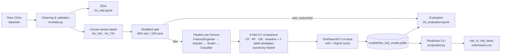

# Fire Crisis Risk Prediction

Predict the **risk (0–100%) that a wildfire comes within 5 km of an evacuation zone** within **12, 24, 48 and 72 hours** after t0+5h, using only what was observed in the fire's first 5 hours.

Data and scoring: WiDS Worldwide Global Datathon 2026 (wildfire evacuation task).

---

## 1. Goal and problem framing

Emergency managers need two things from a forecast:
- a **ranking** of fires by urgency, for triage
- **calibrated probabilities**, for threshold-based warnings

The competition frames this as **right-censored survival analysis**:
- If a fire hits within the 72 h window: `event = 1`, and `time_to_hit_hours` is the observed time from t0+5h.
- If it doesn't: `event = 0`, and `time_to_hit_hours` is the last observed time (≤ 72 h).

We submit **P(hit by 12 / 24 / 48 / 72 h)** per fire. Each horizon is modelled with its own binary classifier, so this is a classification framing with **risk % = `predict_proba × 100`**. The four probabilities are forced to be non-decreasing (P(12h) ≤ P(24h) ≤ P(48h) ≤ P(72h)).

### Evaluation metric (implemented in `src/model.py`)

```
Hybrid          = 0.3 × C-index + 0.7 × (1 − Weighted Brier)
Weighted Brier  = 0.3 × Brier@24h + 0.4 × Brier@48h + 0.3 × Brier@72h
```

Each Brier@H is **censor-aware**, and the same rule defines our training labels (`censor_aware_labels` in `src/data.py`):

| Fire | Label at horizon H |
|---|---|
| hit at time t | 1 if t ≤ H, else 0 |
| censored at time t > H | 0 |
| censored at time t ≤ H | **excluded** |

- **C-index:** Harrell's concordance on an urgency score, the mean of the four probabilities. The competition does not state which score it uses, so the 72 h column is made rank-consistent with the others (see §7). The C-index then comes out the same whichever column is ranked.
- **Model selection and tuning** both maximise the Hybrid score.
- **Headline risk:** the CLI's `risk_percentage` is the **48 h risk**, the horizon the metric weights most. `risk_band` is derived from it.

## 2. Dataset

Source folder: `WiDSWorldWide_GlobalDathon26/`, copied unchanged into `data/raw/`.

| File | Rows × cols | Content |
|---|---|---|
| `train.csv` | 221 × 37 | 34 features + `event_id` + targets `time_to_hit_hours`, `event` |
| `test.csv` | 95 × 35 | same features, **no labels** (competition test set) |
| `sample_submission.csv` | 95 × 5 | `event_id, prob_12h, prob_24h, prob_48h, prob_72h` |
| `metaData.csv` | 37 rows | column dictionary |

There are no missing values, no duplicates and no `event_id` overlap between train and test. All features are numeric:

| Group | Columns | Meaning |
|---|---|---|
| Temporal coverage | `num_perimeters_0_5h`, `dt_first_last_0_5h`, `low_temporal_resolution_0_5h` | how many fire perimeters were mapped in the first 5 h, and over what span |
| Growth | `area_first_ha`, `area_growth_*`, `log1p_*`, `relative_growth_0_5h`, `radial_growth_*` | initial size (ha) and how fast the area grew |
| Centroid kinematics | `centroid_displacement_m`, `centroid_speed_m_per_h`, `spread_bearing_*` | how far and in which direction the fire's centre moved |
| Distance | `dist_min_ci_0_5h`, `dist_*`, `closing_speed_*`, `projected_advance_m` | distance (m) to the nearest evacuation-zone centroid and how fast it is shrinking |
| Directionality | `alignment_cos/abs`, `cross_track_component`, `along_track_speed` | whether the fire moves toward the evacuation zone |
| Time metadata | `event_start_hour`, `event_start_dayofweek`, `event_start_month` | when the fire started |

**Target:** `event` (1 = hit within 72 h, 31% of fires) and `time_to_hit_hours`. Censored fires were last observed at 0.4–67 h, never at 72 h, so the censor-aware labels look like this (all 221 training fires):

| Horizon | Positive | Negative | Excluded (censored before H) |
|---|---|---|---|
| 12 h | 49 | 166 | 6 |
| 24 h | 63 | 133 | 25 |
| 48 h | 66 | 100 | 55 |
| 72 h | 69 | **0** | 152 |

At 72 h every evaluable fire is a hit.

## 3. Setup and run (uv only, inside WSL)

The project runs in **WSL (Ubuntu)**. It lives in a OneDrive folder, so the virtual environment is kept on the Linux side (`~/.venvs/fire-risk-model`) through `UV_PROJECT_ENVIRONMENT`. This keeps OneDrive from syncing thousands of package files and makes installs much faster.

```bash
# 1. open WSL and go to the project
cd "/mnt/c/Users/<you>/OneDrive/Desktop/New folder/fire-risk-model"

# 2. point uv at a Linux-side venv (add this line to ~/.bashrc to make it permanent)
export UV_PROJECT_ENVIRONMENT=$HOME/.venvs/fire-risk-model

# 3. install the exact locked dependencies
uv sync

# 4. register the Jupyter kernel
uv run python -m ipykernel install --user --name fire-risk --display-name "Fire Risk (uv)"

# 5. run every notebook top to bottom (about 4 min, mostly the grid search)
uv run jupyter nbconvert --to notebook --execute --inplace notebooks/01_eda.ipynb notebooks/02_training.ipynb notebooks/03_evaluation.ipynb

# or explore interactively
uv run jupyter lab
```

Dependencies (pinned in `pyproject.toml` / `uv.lock`): pandas, numpy, scikit-learn, matplotlib, jupyterlab, ipykernel, joblib, nbconvert. Python 3.15.

## 4. Project structure

```
fire-risk-model/
├── pyproject.toml / uv.lock
├── data/
│   ├── raw/            original competition files (never modified)
│   ├── processed/      train_clean.csv (with hit_* labels), dev_set.csv (85%)
│   └── test/           test_set.csv (15% held out), sample_input.csv, sample_predictions.csv
├── notebooks/          01_eda, 02_training, 03_evaluation
├── src/
│   ├── data.py         loading, validation, cleaning, censor-aware horizon labels
│   ├── features.py     engineered features + FeatureEngineer transformer
│   ├── model.py        pipeline builder, MultiHorizonRiskModel, competition metric, risk bands
│   └── predict.py      CLI: score a CSV with the saved model
├── models/fire_risk_model.joblib
└── reports/
    ├── figures/        every chart as PNG
    ├── cv_results.csv, test_metrics.csv
    ├── test_predictions.csv, submission.csv   (predictions for the 95 competition fires)
```

`src/model.py` is an addition to the requested layout. It holds the custom multi-horizon estimator, which has to live in an importable module so that the saved joblib file can be loaded by `predict.py`.

## 5. ML pipeline



## 6. EDA findings

Full details are in `notebooks/01_eda.ipynb`.

1. **A single feature separates the 72 h outcome perfectly.** Every fire that hit had a minimum distance to an evacuation zone of ≤ 4.7 km in its first 5 h, and every fire that didn't was ≥ 5.2 km away. The target itself is defined at 5 km. Whether a fire hits is almost a lookup; **when** it hits is the real problem. See [01_distance_vs_target.png](reports/figures/01_distance_vs_target.png).
2. **Hits come early and censoring is heavy.** The median time to hit is 3.5 h, and 49 of the 69 hits happen within 12 h. Censored fires were last observed before 72 h, so the metric excludes 25 / 55 / 152 of them at 24 / 48 / 72 h. See [01_target_distribution.png](reports/figures/01_target_distribution.png).
3. **Growth and movement features are mostly zero.** 73% of fires have only one perimeter, so about 89% of growth values are 0 and the rest are extremely skewed. See [01_feature_histograms.png](reports/figures/01_feature_histograms.png) and [01_boxplots.png](reports/figures/01_boxplots.png).
4. **There are redundant feature groups**, e.g. identical relative-growth columns. See [01_correlation_heatmap.png](reports/figures/01_correlation_heatmap.png).
5. **Fires with several perimeters hit more often** (60% vs 20%), which is likely a monitoring/selection effect. See [01_category_hit_rates.png](reports/figures/01_category_hit_rates.png).
6. **There are no date, location or categorical columns.** Seasonality is weak (fires peak in Jun–Aug). See [01_time_trends_month.png](reports/figures/01_time_trends_month.png) and [01_top_correlations.png](reports/figures/01_top_correlations.png).

**Consequences for modelling:**
- tree ensembles, because the signal is a sharp threshold and the features are zero-inflated
- engineered distance features: `log_dist_min`, `dist_minus_radius_km`, `eta_hours`
- stratified splits
- censor-aware labels
- the official Hybrid score as the selection metric. It is 70% Brier, so calibration matters most.

## 7. Model comparison and final metrics

**Split:** stratified 85% development (187 rows) / 15% test (34 rows), `random_state=42`. Model selection uses 5-fold CV on the development set. With 221 rows, a separate 15% validation set would be too small to be useful.

**Label strategies compared:**
- `censor_aware`: censored-before-H fires are dropped from the H model, exactly like the metric.
- `metadata`: censored fires are negatives at every horizon.

**5-fold CV on the development set, official metric** ([02_cv_model_comparison.png](reports/figures/02_cv_model_comparison.png)):

| Model | Labels | Hybrid ↑ | Weighted Brier ↓ | C-index ↑ |
|---|---|---|---|---|
| Baseline (prior) | censor-aware | 0.7381 | 0.1599 | 0.5000 |
| LogisticRegression | censor-aware | 0.9384 | 0.0500 | 0.9112 |
| GradientBoosting | metadata | 0.9686 | 0.0207 | 0.9434 |
| RandomForest (default) | metadata | 0.9728 | 0.0181 | 0.9516 |
| RandomForest (default) | censor-aware | 0.9735 | 0.0185 | 0.9546 |
| **RandomForest (tuned)** | **censor-aware** | **0.9756** | **0.0145** | **0.9527** |

**Final model:** a Random Forest per horizon (`n_estimators=500, max_features=0.5, min_samples_leaf=5, max_depth=None`), trained on censor-aware labels.

**The 72 h horizon:** under censor-aware labels, every evaluable training fire is a hit, so there is nothing to classify. The 72 h output is the smoothed base rate c ≈ 0.98, plus a rank-preserving term: `c + (1 − c) · mean(P12, P24, P48)`. This minimises Brier@72h and keeps the column ordered by urgency. It is a metric artefact, not an operational forecast.

**Held-out test set (34 fires, 11 hits), competition metric** (`reports/test_metrics.csv`, [03_competition_score.png](reports/figures/03_competition_score.png)):

| Metric | Test | 95% bootstrap CI | 5-fold CV (dev) |
|---|---|---|---|
| **Hybrid score** | **0.972** | 0.943 – 0.995 | 0.976 |
| Weighted Brier | 0.013 | 0.000 – 0.039 | 0.015 |
| C-index | 0.936 | 0.879 – 0.988 | 0.953 |
| Brier@24h / @48h / @72h | 0.038 / 0.003 / 0.000 | | |

**Per-horizon classification on evaluable rows (threshold 0.5):**

| Horizon | Evaluable | ROC-AUC | PR-AUC | Accuracy | Precision | Recall | F1 |
|---|---|---|---|---|---|---|---|
| 12 h | 33 | 0.975 | 0.929 | 0.879 | 0.750 | 0.750 | 0.750 |
| 24 h | 27 | 0.976 | 0.957 | 0.963 | 0.909 | 1.000 | 0.952 |
| 48 h | 24 | 1.000 | 1.000 | 1.000 | 1.000 | 1.000 | 1.000 |
| 72 h | 11 (all hits) | n/a | n/a | 1.000 | n/a | 1.000 | n/a |

- **Calibration:** the 12/24/48 h out-of-fold reliability curves sit on the diagonal ([03_calibration.png](reports/figures/03_calibration.png)).
- **C-index robustness:** ranking on `prob_12h`, `prob_24h` or `prob_48h` gives 0.933, and ranking on `prob_72h` gives 0.944.
- **Timing among fires that hit:** telling an early hit (≤ 12 h) from a late one gives AUC ≈ 0.78 out-of-fold. This is the main limit on the C-index ([03_timing_among_hits.png](reports/figures/03_timing_among_hits.png)).
- **Permutation importance** (Hybrid drop) is dominated by `dist_min_ci_0_5h` ([03_permutation_importance.png](reports/figures/03_permutation_importance.png)).
- **Risk bands:** see [03_risk_bands.png](reports/figures/03_risk_bands.png).

## 8. Predicting on new data

The input CSV needs the 34 feature columns (any extra columns, such as `event_id`, are kept in the output):

```bash
uv run python src/predict.py --input data/test/sample_input.csv --output predictions.csv
```

The output contains the original columns plus:

| Column | Meaning |
|---|---|
| `risk_12h_pct` … `risk_72h_pct` | probability (%) that the fire comes within 5 km of an evacuation zone within each horizon (from t0+5h) |
| `risk_percentage` | headline risk, equal to the **48 h** risk (the horizon the metric weights most) |
| `risk_band` | Low (0–25) · Medium (25–50) · High (50–75) · Critical (75–100), from `risk_percentage` |

To produce the competition submission (`event_id, prob_12h, prob_24h, prob_48h, prob_72h`, monotone, in [0, 1]):

```bash
uv run python src/predict.py --input data/raw/test.csv --output reports/test_predictions.csv --submission reports/submission.csv
```

## 9. Limitations and next steps

**Limitations**
- **Very small dataset** (221 labelled fires, 34 for testing). The Hybrid score's confidence interval is about ±0.03.
- **The C-index score definition is not stated by the competition.** We rank on the mean probability and made the 72 h column rank-consistent as a hedge.
- **The 72 h probability (about 98–100% for every fire) is a scoring artefact.** No censored fire is evaluable at 72 h. Use the 12/24/48 h risks for decisions.
- **Whether a fire hits rests on one threshold** (distance ≈ 5 km). A fire just beyond 5 km that grows fast could still hit, but there is no such case in training.
- **Probabilities at 12–48 h are extreme (about 0% or 100%).** In operations, floor the risk at a small value.
- **Timing (early vs. late hit) is only moderately predictable** from 5 h of perimeter data.
- **Possible monitoring bias:** fires with more perimeters hit more often.
- **No weather, wind, fuel or terrain inputs.**

**Next steps**
- Add wind speed and direction, fuel moisture, slope and road-network distance.
- Try a proper survival model (a discrete-time hazard model, random survival forest, or AFT model) or IPCW-weighted classifiers that use the censoring times directly.
- Use repeated or nested CV for more stable model selection on such small data.
- Validate on fires from another season or region.
